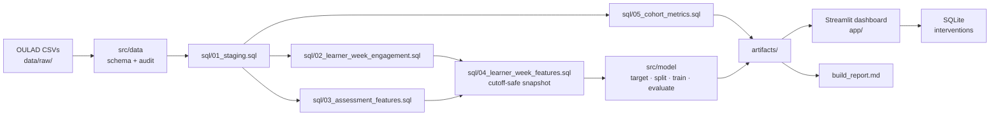

# Learner Churn Early-Warning Dashboard

A small, reproducible product-analytics application that helps an EdTech
operations team identify learners who may not complete a course **early enough
for a meaningful intervention**.

It ingests the public [Open University Learning Analytics Dataset
(OULAD)](https://analyse.kmi.open.ac.uk/open_dataset), builds weekly engagement
and assessment features with SQL (DuckDB), trains a transparent logistic
baseline in Python at a documented prediction cutoff, and presents cohort
outcomes, activity drop-off, an explainable at-risk queue and a local
intervention workflow in a Streamlit dashboard.

> **This is an analytical decision-support prototype, not a student-surveillance
> system.** It runs on anonymised, retrospective research data. Nothing here
> contacts a learner, and no score should be treated as a judgement about one.

---

## Results at a glance

Every figure below is produced by running the pipeline against the real OULAD
dataset (32,593 learner-course records, 10.6M clickstream rows). Regenerate them
with `python -m src.pipeline`; nothing is hard-coded.

| | |
|---|---|
| Learner-course records | 32,593 (28,785 distinct learners) |
| Course presentations | 22 across 7 modules |
| Outcome mix | Pass 37.9% · Withdrawn 31.2% · Fail 21.6% · Distinction 9.3% |
| Prediction cutoff | end of course-relative week 4 (day 27) |
| Primary target | Withdrawn = 1; Pass/Distinction = 0; **Fail excluded** |
| Modelling cohort | 25,541 records (7,052 Fail rows excluded by the target) |
| Features | 47 |
| Held-out ROC-AUC | **0.885** |
| Held-out PR-AUC | **0.879** (baseline prevalence 0.397) |
| Operating threshold | 0.734, chosen on validation under a 25% queue cap |
| Precision / Recall / F1 | **0.940** / **0.613** / **0.742** |
| Test split | 3,193 learners (827 flagged, 25.9% of the cohort) |
| Confusion (test) | TP 777 · FP 50 · FN 490 · TN 1,876 |
| 5-fold grouped CV PR-AUC | 0.872 ± 0.005 |
| Majority-class baseline | 0.603 accuracy (which is why accuracy is not the headline) |
| Shallow tree comparison | validation PR-AUC 0.809 — worse than the logistic baseline |
| Steepest activity decline | **week 11: −17.2%** (17,559 → 14,544 active learners) |
| Tests | **118 passing** |

The steepest measured activity declines across all cohorts are weeks 11 (−17.2%),
25 (−8.6%) and 9 (−7.5%). These are **activity** declines, not withdrawals.

---

## Architecture



**Stack** — Python 3.11+ · DuckDB (embedded SQL) · pandas · scikit-learn ·
Streamlit · Plotly · pytest. No paid services, no credentials, no external
database, no network access at run time.

---

## Quick start

```bash
cd ~/Desktop/Learner-Churn-Early-Warning-Dashboard
python3 -m venv .venv
source .venv/bin/activate
pip install -r requirements.txt
```

Then either fetch the dataset automatically:

```bash
python -m src.pipeline --download
```

…or place the seven OULAD CSVs in `data/raw/` yourself (see below), then:

```bash
python -m src.pipeline
```

Finally:

```bash
streamlit run app/Home.py
```

A bootstrap script that does all of the above is provided:

```bash
bash scripts/bootstrap.sh
```

### The individual commands

```bash
python -m src.data.download --data-dir data/raw     # fetch OULAD (optional)
python -m src.data.audit --data-dir data/raw        # schema + data audit
python -m src.features.build --data-dir data/raw    # SQL feature layer
python -m src.model.train --cutoff-week 4           # train + evaluate
python -m src.model.train --target fail_as_churn    # sensitivity target
pytest                                              # full test suite
streamlit run app/Home.py                           # dashboard
```

---

## Getting the data

OULAD is published by The Open University's Knowledge Media Institute.

1. Open <https://analyse.kmi.open.ac.uk/open_dataset>
2. Download the dataset archive (mirrored at
   <https://archive.ics.uci.edu/dataset/349/open+university+learning+analytics+dataset>)
3. Extract these seven files into `data/raw/`:

```
data/raw/
├── courses.csv
├── assessments.csv
├── vle.csv
├── studentInfo.csv
├── studentRegistration.csv
├── studentAssessment.csv
└── studentVle.csv
```

4. Verify with `python -m src.data.audit --data-dir data/raw`

The raw dataset is **not** committed or shipped in the ZIP: it is ~450 MB and
is redistributed under its own terms. The pipeline always tells you exactly
which files are missing.

---

## How the analysis is designed

### Week mapping

OULAD date fields are day offsets from the start of a presentation. This project
defines:

```
week = floor(day / 7) + 1     for day >= 0
```

so **day 0 belongs to week 1** and week 4 covers days 21–27. Negative offsets are
pre-course activity: they are excluded from the weekly series and captured
separately as `pre_course_clicks` rather than being silently dropped.

### Target definition

`final_result` has four values and they are not interchangeable. The **primary
target** is:

- **Positive** — `Withdrawn`
- **Negative** — `Pass`, `Distinction`
- **Excluded** — `Fail`

Fail is excluded rather than folded into the positive class because failing and
withdrawing are different behaviours, and mixing them would make the headline
number uninterpretable. A documented **sensitivity target**
(`--target fail_as_churn`) counts Withdrawn *or* Fail as non-completion, so the
cost of that choice is visible rather than hidden. Both definitions appear in
the sidebar and the model card.

### Prediction cutoff and leakage control

Features use **only** records observed on or before the last day of the cutoff
week. Never used as features: `final_result`, post-cutoff clicks, post-cutoff
scores, `date_unregistration`, or any whole-course aggregate.

Leakage is prevented structurally and verified empirically:

| Control | Where |
|---|---|
| Explicit feature allow-list; undeclared columns raise | `src/model/features.py` |
| Deny-list with a stated reason per column | `src/model/features.py` |
| Per-week features filtered to `week <= cutoff` in SQL | `sql/04_learner_week_features.sql` |
| Grouped split by learner-course presentation | `src/model/pipeline.py` |
| Preprocessing fitted inside the pipeline (train folds only) | `src/model/pipeline.py` |
| **Injection test: post-cutoff activity must not move week-4 features** | `tests/test_leakage.py` |

### Missing data

Two different kinds of "nothing" are kept apart:

- **No clickstream row** means zero clicks. Week columns are `COALESCE`d to 0.
- **No score** means *not observed*. `mean_score` stays null and an explicit
  `has_no_score_by_cutoff` flag tells the model which case it is. A missing score
  is never imputed to zero.

### Assessment lateness

`assessments.csv` carries a real due-date field for 195 of 206 assessments
(94.7%); the rest — mostly Exams — record `?`. Lateness is computed **only**
where a genuine due date exists and is reported as unavailable elsewhere. No due
date is ever inferred or fabricated.

### Model and threshold

A scikit-learn `LogisticRegression` (`class_weight="balanced"`, L2) inside a
reproducible `ColumnTransformer` pipeline. The operating threshold is chosen on
a **validation split** — never on the test set — by an explicit rule:

> Among thresholds flagging at most 25% of the cohort (the mentor-capacity
> constraint), take the one with the highest F1.

The test set is then scored **once**, at that frozen threshold.

---

## Dashboard

| Page | What it answers |
|---|---|
| **Overview** | How big is the cohort, what are the outcomes, where does activity fall? |
| **Engagement** | Weekly active rate, click volume, drop-off, activity distribution, assessment participation and lateness |
| **Risk queue** | Who is highest risk, why, and how do I export the list? |
| **Learner detail** | What did this learner actually do, week by week, before the cutoff? |
| **Interventions** | Route a reviewed learner to a simulated owner and track status |
| **Model & data quality** | Target, cutoff, held-out metrics, threshold trade-off, leakage controls, limitations |

Global filters (course, presentation, prediction week, target definition, risk
bands) are in the sidebar and change the displayed results.

Every page renders an honest empty state — "Load OULAD data to calculate" — when
its artifact is missing. No headline card ever shows a fabricated number.

---

## Tests

```bash
pytest                       # 118 tests
pytest tests/test_leakage.py # just the leakage guarantees
```

| File | Covers |
|---|---|
| `test_week_mapping.py` | day → week mapping, day 0, negative days, SQL/Python agreement |
| `test_target.py` | positive/negative/excluded split, unknown labels, prevalence |
| `test_leakage.py` | post-cutoff injection, forbidden columns, grouped split, cutoff-scoped columns |
| `test_join_grain.py` | key uniqueness, no row multiplication, dataset validation failures |
| `test_data_quality.py` | non-negative clicks, bounded probabilities, missing ≠ zero, lateness rules |
| `test_metrics.py` | AUC/PR-AUC correctness, single-class "not available", threshold curve, capacity rule |
| `test_interventions.py` | CRUD, validation, audit timestamps, no contact fields in schema |
| `test_integration.py` | fixture CSV → SQL → model → artifacts → dashboard loaders |
| `test_dashboard.py` | every page renders headlessly against real artifacts, filters change results, no raw `nan`, and pages degrade gracefully without artifacts |

The suite runs against a small synthetic OULAD fixture (12 learners, all four
outcomes, undated exams, pre-course activity, an early unregisterer), so it
needs no dataset download and takes ~35 seconds.

---

## Project layout

```
Learner-Churn-Early-Warning-Dashboard/
├── app/
│   ├── Home.py                     # Overview
│   ├── _shared.py                  # design system, filters, empty states
│   └── pages/
│       ├── 1_Engagement.py
│       ├── 2_Risk_Queue.py
│       ├── 3_Learner_Detail.py
│       ├── 4_Interventions.py
│       └── 5_Model_and_Data_Quality.py
├── src/
│   ├── config.py                   # every tunable, in one place
│   ├── pipeline.py                 # one-command run path
│   ├── data/                       # schema, audit, download
│   ├── db/duck.py                  # DuckDB helpers + SQL templating
│   ├── features/build.py           # SQL build → artifacts
│   ├── model/                      # target, features, pipeline, evaluate, train
│   ├── analytics/                  # loader, report
│   └── interventions/store.py      # SQLite workflow
├── sql/                            # 01_staging … 05_cohort_metrics
├── tests/                          # 118 tests
├── docs/
│   ├── data_dictionary.md
│   ├── model_card.md
│   └── intervention_playbook.md
├── scripts/bootstrap.sh
├── data/raw/                       # user-provided OULAD (gitignored)
├── artifacts/                      # generated metrics, model, queues
└── requirements.txt
```

---

## Troubleshooting

| Symptom | Fix |
|---|---|
| `Dataset incomplete. Missing: ...` | Put the seven CSVs in `data/raw/`, or run `python -m src.pipeline --download` |
| Dashboard says "No feature snapshot" | `python -m src.pipeline` (or `python -m src.features.build`) |
| Dashboard says "No risk queue yet" | `python -m src.model.train --cutoff-week 4` |
| Sidebar says the artifact is for another week | Re-train with `--cutoff-week <n>`; the app tells you which week it scored |
| `ModuleNotFoundError: src` | Run commands from the project root, or use `scripts/bootstrap.sh` |
| Streamlit port busy | `streamlit run app/Home.py --server.port 8502` |

---

## Data refresh

Drop new CSVs into `data/raw/` (same filenames and columns) and re-run
`python -m src.pipeline`. The SQL layer is fully rerunnable; every stage
validates its inputs before writing, so a malformed file fails loudly instead of
producing a partially-updated artifact.

---

## Privacy, ethics and limitations

- OULAD identifiers are already pseudonymous. No re-identification is attempted
  and no contact data is collected, stored or required anywhere in the app.
- A risk score is a **rank-ordering of observed behaviour**. It does not
  establish a learner's intent, ability, or a cause for withdrawal.
- Human review is required before any action. The intervention workflow
  demonstrates a *process*; it claims no measured time saving or retention
  uplift, because none was measured.
- Fairness-sensitive attributes (`region`, `imd_band`, `age_band`, `gender`,
  `disability`) are available to the model because they exist at prediction time,
  but they are flagged in the model card and must not drive intervention
  decisions on their own.
- The dataset is retrospective research data. External validity to a live LMS
  feed is unproven, and the model is not validated for real student-support
  decisions.

See [`docs/model_card.md`](docs/model_card.md) for the full statement.

---

## Attribution

This project uses the **Open University Learning Analytics Dataset (OULAD)**,
created by the Knowledge Media Institute at The Open University (Kuzilek,
Hlosta & Zdrahal). Please cite the dataset's original publication and review its
terms of use at <https://analyse.kmi.open.ac.uk/open_dataset>. The dataset is
not redistributed with this project.

Built as a portfolio/demonstration project. Not affiliated with or endorsed by
The Open University.
